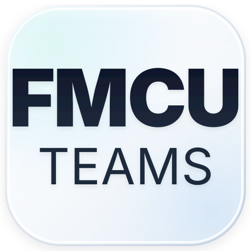

# FMCUTEAMS - Medicines Reminder Web & Mobile App

A modern, pastel claymorphic / neumorphic medicine reminder web application duplicated from the mobile and desktop design specifications, complete with a matching authentication/login experience and ready for one-click deployment on **Vercel**.



---

## ✨ Features

- **Exact Design Duplicate**:
  - **Screen 1 (Home / Dashboard)**: Horizontal calendar week strip with active coral pink capsule pill, Today/Week/Month period filter tabs, medicine cards with dosage, custom tags, and a floating bottom dock.
  - **Screen 2 (Medicine Detail)**: 3D hero illustration (Meglitinides with yellow sun disk, lavender-blue capsule, and green pedestal), coral "Remove" action button, description, timing badges, 2x2 stat grid (Amount, This Month, Cause, Cap Size), and "Edit Schedule" button.
  - **Screen 3 (New Reminder Form)**: 3D dual capsule hero, medicine name input, 4-type selector (Syrup, Capsule with blue shadow highlight, Injection, Tablet), timing tags, duration & frequency selectors, and "Add Reminder" button.
- **Login / Register Page**:
  - Matching dreamy pastel ambient glow aesthetic.
  - 3D medical hero illustration.
  - Sign In / Sign Up tabs, remember me, forgot password, social login pills, and a 1-click **Instant Demo Login**.
- **Responsive Modes**:
  - **3-Phones Showcase View**: Displays all 3 mobile mockups side-by-side on an ambient pastel backdrop just like the reference photo.
  - **Full Desktop Dashboard View**: Fullscreen desktop web app with sidebar navigation, summary analytics cards, medicine list, and active medicine inspector.
  - **Single Mobile View**: Standalone phone frame for testing mobile interactions.
- **Interactive State**:
  - Add new medicines dynamically from the form.
  - Mark doses as taken with celebratory confetti animations.
  - Edit or remove medicines.
  - LocalStorage persistence for medicine records and user session.

---

## 🚀 Quick Start

### 1. Install Dependencies
```bash
npm install
```

### 2. Run Locally in Development Mode
```bash
npm run dev
```

### 3. Build for Production
```bash
npm run build
```

---

## 🌐 Deploy to Vercel

This repository is pre-configured with `vercel.json` and optimized for automatic deployment on Vercel:

1. Push this repository to GitHub:
   ```bash
   git add .
   git commit -m "feat: complete mobile & desktop medicine reminder with login"
   git push origin main
   ```
2. Log into [vercel.com](https://vercel.com) and click **"Add New..." > "Project"**.
3. Import the `FMCUTEAMS` repository from your GitHub account (`squizzberry2001-star/FMCUTEAMS`).
4. Vercel automatically detects the Vite framework and sets:
   - **Framework Preset**: Vite
   - **Build Command**: `npm run build`
   - **Output Directory**: `dist`
5. Click **Deploy**. Your site will be live on Vercel in seconds!

---

Developed with ❤️ for FMCU TEAMS.
